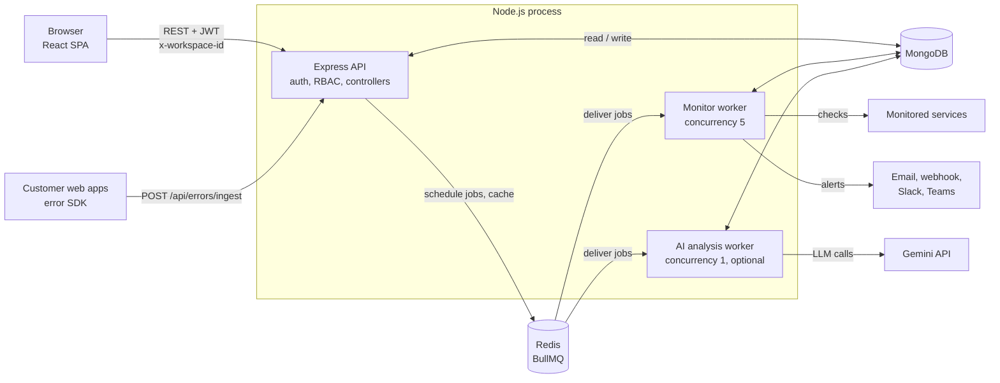
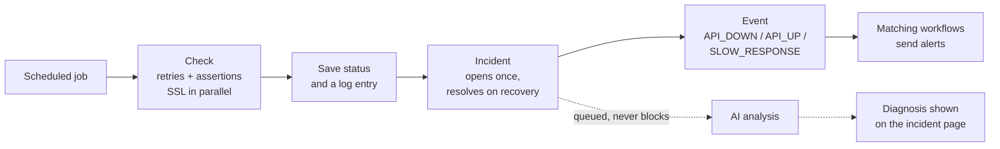
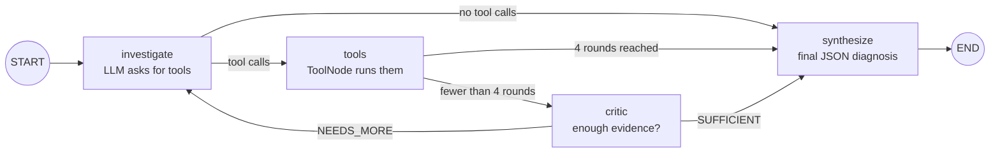

# DevFlow OS: API Monitor

[](https://github.com/tanmaysde/monitor-api/actions/workflows/ci-cd.yml)

A multi-tenant uptime and API monitoring platform. Teams add monitors for their HTTP, TCP, DNS or ping endpoints; a background job queue checks them on a schedule; outages open incidents and send alerts; and an optional AI agent investigates each outage and suggests a probable cause with evidence. It also includes a small Sentry-style error tracker for front-end exceptions.

**API:** `https://monitor-api-c77n.onrender.com` (health check at [`/healthz`](https://monitor-api-c77n.onrender.com/healthz))

---

## Features

- **Monitoring**: HTTP, TCP, DNS (A, AAAA, CNAME, MX, TXT) and ping checks, with retries before a monitor is marked down, SSL certificate expiry tracking, and assertions on status code, response time, body text or a JSON path.
- **Scheduling**: one repeatable BullMQ job per monitor, processed by a worker; missing schedules are re-created at startup.
- **Logs and analytics**: every check is logged; uptime %, average, fastest and slowest response time per monitor (cached for 60 seconds).
- **Incidents**: an incident opens automatically when a monitor goes down (never duplicated) and resolves when it recovers. People can acknowledge, assign, comment and resolve, with a full timeline.
- **Workflows**: "when this event happens, do this" automation. Events are `API_DOWN`, `API_UP` and `SLOW_RESPONSE`; actions are email, webhook, Slack and Microsoft Teams. A workflow can apply to every monitor or only selected ones, and every run is recorded.
- **AI root-cause analysis** (off by default): a LangGraph agent reads logs, SSL status, related exceptions, other monitors and DNS, has a critic step check the evidence, then writes a probable cause, confidence, evidence and next steps onto the incident.
- **Error tracking (mini-Sentry)**: a one-line script tag captures uncaught browser errors, groups duplicates by fingerprint, and shows counts by browser, OS and page.
- **Teams**: workspaces with four roles (Owner, Admin, Member, Viewer). All data is scoped to a workspace.

## Architecture



The API and both workers currently run in one Node process and only communicate through Redis and MongoDB, so the workers can be moved to their own service when load requires it.

### What happens when a service goes down



### The AI agent



The five tools (recent logs, SSL info, related exceptions, other monitors' status, DNS lookup) are read-only. The workspace and monitor ids are taken from the incident and fixed when the tools are created, so the model can never choose them. Tool output is treated as untrusted data, the graph is capped at four rounds, and analyses are limited per workspace per day. The whole feature is behind `AI_ANALYSIS_ENABLED`, and when it is off, stored analyses are removed from API responses.

## Tech stack

| Area | Technology |
|---|---|
| Backend | Node.js 20, Express 5, TypeScript |
| Database | MongoDB with Mongoose (TTL indexes expire logs and events after 30 days) |
| Queue and cache | BullMQ on Redis (ioredis) |
| Auth | JWT access tokens (15 min), httpOnly refresh cookie (7 days), bcrypt |
| AI | LangGraph, LangChain tools with Zod schemas, Google Gemini |
| Alerts | Nodemailer (SMTP), webhooks, Slack, Microsoft Teams |
| Frontend | React 18, Vite, TypeScript, Tailwind CSS, React Router |
| Tooling | GitHub Actions (type-check and build), Docker, Winston logging |

## Getting started

### Prerequisites

- Node.js 20
- MongoDB on `localhost:27017`
- Redis on `localhost:6379`. With Docker: `docker run -d --name redis -p 6379:6379 redis:7-alpine`

### 1. Backend

```bash
cd backend
cp .env.example .env      # then set JWT_SECRET, JWT_REFRESH_SECRET and MONGO_URI
npm install
npm run dev               # http://localhost:5000
```

### 2. Frontend

```bash
cd frontend
cp .env.example .env      # VITE_API_BASE_URL=http://localhost:5000/api
npm install
npm run dev               # http://localhost:5173
```

### 3. Demo data (optional)

`npm run seed` (in `backend/`) creates a demo workspace with six monitors covering healthy, slow, flaky, down, expired-SSL and DNS-failure cases, seven days of logs, incidents and exceptions. It writes to `SEED_MONGO_URI` and refuses to run if that equals `MONGO_URI`. To use it, point `MONGO_URI` at the same database and set `SYNC_MONITOR_JOBS=false` so the demo's fake URLs are not checked.

Log in with `demo@example.com` / `Demo@1234`.

### 4. AI analysis (optional)

Set `GEMINI_API_KEY`, `GEMINI_MODEL` and `AI_ANALYSIS_ENABLED=true`, then restart the backend. An "Analyze with AI" panel appears on incident pages. `npm run ai:eval` runs the agent against the seeded scenarios and checks its diagnoses.

## Configuration

All backend settings are documented in [`backend/.env.example`](backend/.env.example). The main ones:

| Variable | Purpose |
|---|---|
| `MONGO_URI`, `REDIS_URL` | Database and Redis (`rediss://` enables TLS, e.g. Upstash) |
| `JWT_SECRET`, `JWT_REFRESH_SECRET` | Token signing |
| `SMTP_*` | Email alerts |
| `GEMINI_API_KEY`, `GEMINI_MODEL`, `AI_ANALYSIS_ENABLED`, `AI_DAILY_LIMIT` | AI analysis |
| `CORS_ORIGINS` | Allowed browser origins (set this in production) |
| `COOKIE_SECURE`, `COOKIE_SAMESITE` | Refresh-cookie flags for HTTPS or cross-site deployments |
| `ALLOW_PRIVATE_WEBHOOK_TARGETS` | Disables the SSRF guard for local testing only |
| `SYNC_MONITOR_JOBS` | Re-create missing check schedules at startup (default on) |

## Project structure

```
backend/src
  app.ts, server.ts      Express setup and startup
  middlewares/           auth (JWT + token version) and workspace role checks
  routes/, controllers/  HTTP layer
  services/              checks, assertions, SSL, incidents, events, workflows,
                         alert actions, AI agent and tools
  jobs/                  BullMQ queues and workers
  models/                Mongoose schemas
  scripts/               seed, AI eval, tool smoke tests
frontend/src
  pages/                 dashboard, monitors, workflows, incidents, issues, team
  components/            forms, AI analysis panel, UI kit
  context/               auth and active workspace
  lib/api.ts             typed API client (token refresh, workspace header)
```

## Design decisions

| Decision | Why | Trade-off |
|---|---|---|
| Job queue instead of timers | Schedules survive restarts; retries and concurrency are built in; workers can be added | Requires Redis; retries currently wait inside the job and hold a worker slot |
| Workers in the API process | One deployable unit on free hosting tiers | API and workers cannot scale separately yet |
| Tenant = workspace, filtered on every query | One rule that is easy to audit; a foreign id simply returns 404 | Each controller has to keep the filter |
| Embedded timelines, comments and members | Read together in one query | Not suitable for lists that grow without limit |
| TTL indexes on logs and events | Bounded storage without a cleanup job | Raw history is kept for 30 days |
| AI: the model suggests, the code executes | Ids come from the database, tools are read-only, rounds and daily usage are capped | Each analysis costs 2 to 8 LLM calls; a diagnosis can be wrong, so evidence is always shown |

## Security

- Passwords hashed with bcrypt; short-lived access tokens; all sessions can be revoked by bumping a per-user token version.
- Role checks on every route and workspace filtering on every query.
- Request bodies are whitelisted per field, so clients cannot set fields such as `workspaceId` or `status`.
- Ping checks run the system `ping` without a shell and only accept a plain hostname or IP address.
- Webhook, Slack and Teams requests refuse private and internal addresses (checked at connection time) and do not follow redirects.
- Helmet headers and rate limiting on the API.

## Known limitations

- No automated tests yet; CI checks types and builds only.
- The error-ingestion endpoint is identified only by workspace id, not a secret key.
- CORS accepts any origin unless `CORS_ORIGINS` is set.
- The monitor and AI workers are not yet separate services.
- `docker-compose.yml` does not yet run the full stack end to end: the frontend container expects the API on port 5000 while compose publishes it on 3000, and Redis has no published port. Use the steps above for local development.
